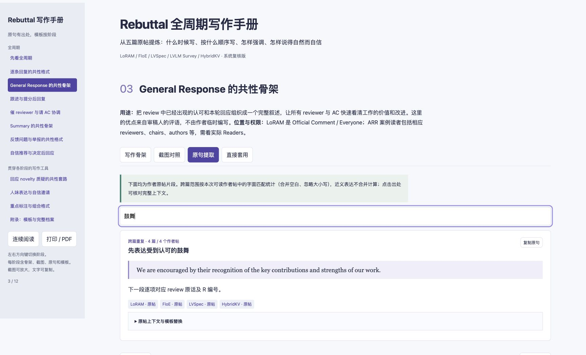

<div align="center">


**把真实的 rebuttal，整理成可以照着写的全周期手册。**

以五篇顶会论文的作者原句和 OpenReview 截图为主，
拆解什么时候回复、写给谁看、怎样组织证据，以及如何自然、自信地表达。

[**下载手册 ZIP**](https://github.com/junzhang-zj/rebuttal-handbook/archive/refs/heads/main.zip) &nbsp; · &nbsp; [阶段写作拆解](共性阶段写作拆解.md) &nbsp; · &nbsp; [英文表达库](Rebuttal英文表达库.md) &nbsp; · &nbsp; [五篇原帖](#五篇原帖)

**5 篇论文** &nbsp; / &nbsp; **104 条可读作者帖** &nbsp; / &nbsp; **69 条原句条目** &nbsp; / &nbsp; **37 张原帖截图**

</div>

## 先打开手册

**[下载手册 ZIP](https://github.com/junzhang-zj/rebuttal-handbook/archive/refs/heads/main.zip)** → 解压 → 在文件夹中找到 **Rebuttal实战手册.html** → 用 Chrome、Edge 或 Safari 打开。

正文、截图和交互代码均已内嵌，**单个 HTML 文件即可离线阅读和分享**。ZIP 包含手册与配套素材；如果只想转发手册，解压后发送 HTML 文件即可。GitHub 文件页与 Raw 链接可能显示源码，不等同于下载入口；微信或网盘的在线预览可能无法运行交互功能。也可通过仓库的 **Code → Download ZIP** 下载。

## 每个阶段，都有四种读法

| 写作骨架 | 截图对照 | 原句提取 | 直接套用 |
| :--- | :--- | :--- | :--- |
| 看清段落顺序、重点和可见性 | 把同阶段的真实原帖放在一起 | 核对作者原句、使用场景和出处 | 替换槽位，写出自己的回复 |



截图可放大，原句可筛选，模板可复制；附录保留完整讨论档案，便于查找上下文。

## 沿着讨论进程写

| 阶段 | 这一阶段要解决什么 | 手册里的内容 |
| :--- | :--- | :--- |
| **第一轮逐条回复** | 正面回答 concern，建立证据链 | 问题引用、直接结论、机制与实验、原稿定位、修改承诺 |
| **General Response** | 让 reviewers 与 AC 快速把握价值和更新 | Reviewer 编号映射、从 review 提炼认可、核心贡献、实验与讨论更新 |
| **后续交流与跟进** | 接住新问题，让讨论继续推进 | 带日期的结果更新、提分后感谢、邀请使用与继续交流 |
| **提醒与请 AC 协调** | 在窗口关闭前争取有效反馈 | 催 reviewer、最后一轮小结、缺少评审、请 AC 邀请参与 |
| **Summary** | 给 AC 一份可核查的讨论总结 | 已解决问题、明确认可与提分、剩余分歧、自信推荐与固定收尾 |
| **问题反馈与报告** | 把争议转成可核查的事实与请求 | 原话与证据对照、遗漏回应、迟到评审、请求独立判断 |

## 不止告诉你“要礼貌”

- **用 review 的肯定组织优点段。** 按研究意义、方法、实验、兼容性和写作归类，保留每项评价的 reviewer 归属。
- **分层回应 novelty。** 区分经验发现与技术创新、已有组件与新框架，再比较对象、粒度、目标及互补关系。
- **自然地说“我们已经考虑过”。** 交代设计阶段的探索、原稿中的位置，再在当前回复中完整重述理由。
- **自信地邀请使用。** 从 “We are happy to…” 到推荐工作，结合适用用户、资源约束和实际证据。
- **让重点在版面上可见。** 对照原帖的加粗、斜体、反引号及组合格式，区分结论、评价和章节定位。

> Wishing you a pleasant day ahead.
>
> 五篇 Summary 中都出现的固定收尾；手册同时解释它的位置、上下文和可复用方式。

## 五篇原帖

| 论文 | 讨论来源 | 可读作者帖 |
| :--- | :--- | ---: |
| **LoRAM** | [ICLR · OpenReview](https://openreview.net/forum?id=s7DkcgpRxL) | 30 |
| **FloE** | [ICML · OpenReview](https://openreview.net/forum?id=i5aHAkkhJH) | 9 |
| **LVSpec** | [ACL / ARR · OpenReview](https://openreview.net/forum?id=xyXsaQEmCu) | 18 |
| **LVLM Survey** | [ACL / ARR · OpenReview](https://openreview.net/forum?id=wvlizZdYc1) | 23 |
| **HybridKV** | [ACL / ARR · 原始讨论论坛](https://openreview.net/forum?id=jFuN2yI2D7) | 24 |

<details>
<summary><strong>整理口径与使用边界</strong></summary>

共保存 145 条讨论记录：104 条可读作者帖、40 条评审及 chairs 的上下文记录、1 条已删除作者帖。仅使用目前可见内容，不补写删除内容或历史版本。

原帖摘录与派生模板分别标注。69 条为精选原句条目，部分功能互有关联；字面重复统计合并空白并忽略大小写，不把近义改写合并。截图与模板可能在相关阶段交叉使用。详见 [逐帖复核与原句追溯索引](sources/systematic_audit.json)。

未继续回复不等同于明确认可，其他 reviewer 的肯定应保留具体评价范围。新增实验、修订、回复入口与可见性须遵循会场当轮规则。

材料来自作者登录会话中可见的讨论，原帖 Readers 信息保留在档案中；访问 OpenReview 链接仍取决于访问者自己的读取权限。

</details>

<details>
<summary><strong>素材目录与重新生成</strong></summary>

| 文件 / 目录 | 用途 |
| :--- | :--- |
| [Rebuttal实战手册.html](Rebuttal实战手册.html) | 完整离线手册 |
| [共性阶段写作拆解.md](共性阶段写作拆解.md) | 阶段结构、表达与模板 |
| [技术与跟进套路补全.md](技术与跟进套路补全.md) | 技术解释和讨论跟进 |
| [Rebuttal时间线与模板指南.md](Rebuttal时间线与模板指南.md) | 时间线与补充模板 |
| [Rebuttal英文表达库.md](Rebuttal英文表达库.md) | 补充英文表达 |
| [sources/](sources/) / [screenshots/](screenshots/) | 原帖文字、核对索引和截图 |

使用 Python 3，在仓库根目录运行：

```sh
python3 build_handbook_v2.py
```

构建仅使用 Python 标准库与仓库内素材。生成的第一版备份为中间产物，无需提交。

</details>
